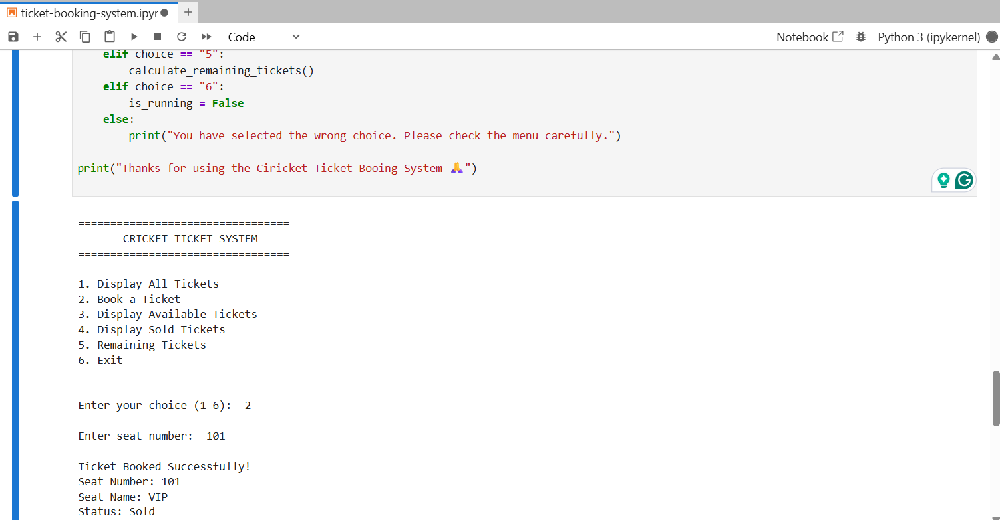
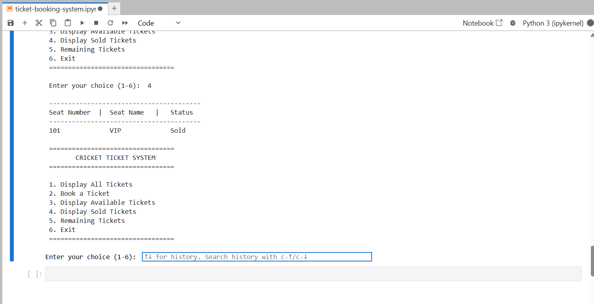
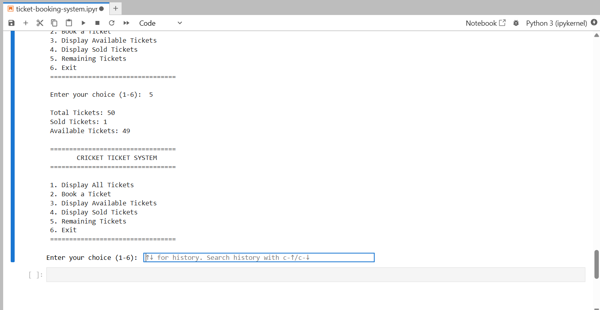

# 🏏 Cricket Ticket Booking System

A simple, menu-driven **Cricket Ticket Booking System** developed using Python. This project allows users to view available tickets, book seats, check booking statuses, and calculate the remaining tickets for a cricket match.

---

## 📌 Project Overview

The system manages cricket match tickets using Python lists. Each ticket contains three attributes:

- **Seat Number:** A unique identifier for each ticket.
- **Seat Name:** The ticket category (VIP, Premium, or General).
- **Booking Status:** The current status of the ticket (Available or Sold).

Initially, all tickets are available. When a customer books a ticket, its status is updated from `Available` to `Sold`.

## ✨ Features

1. **Display All Tickets**
   - View all tickets with their seat numbers, categories, and booking statuses.

2. **Book a Ticket**
   - Enter a desired seat number to book a ticket.
   - Automatically update the booking status to `Sold`.
   - Prevent customers from booking already-sold tickets.
   - Handle invalid seat numbers.

3. **Display Available Tickets**
   - View only tickets that are currently available for booking.

4. **Display Sold Tickets**
   - View all tickets that have already been sold.

5. **Calculate Remaining Tickets**
   - Display the total number of tickets, sold tickets, and available tickets.

6. **Menu-Driven Interface**
   - Continuously display the menu until the user selects the Exit option.

## 🛠️ Concepts Used

This project demonstrates the following Python programming concepts:

- Lists and nested lists
- Variables and data types
- `for` and `while` loops
- Conditional statements (`if`, `elif`, `else`)
- User input using `input()`
- List indexing and element modification
- Searching elements using loops
- Counters and basic calculations
- Functions and program modularity

## 📂 Project Structure

```text
cricket-ticket-booking-system/
│
├── notebooks/
│   └── ticket-booking-system.ipynb
│
└── README.md
```

## 🚀 How to Run

**1. Clone the repository**

```bash
git clone <repository-url>
```

**2. Navigate to the project directory**

```bash
cd cricket-ticket-booking-system
```

**3. Run the Python notebook**

```bash
jupyter notebook
```

## 📋 Application Menu

```text
=================================
       CRICKET TICKET SYSTEM
=================================
1. Display All Tickets
2. Book a Ticket
3. Display Available Tickets
4. Display Sold Tickets
5. Remaining Tickets
6. Exit

Enter your choice:
```

## 📚 Project Objectives

The main objective of this assignment is to strengthen fundamental Python programming skills through a practical ticket booking application.

It provides hands-on experience with list manipulation, loops, conditional logic, searching, and updating records while implementing a simple real-world booking scenario.

## 📌 Assignment Restrictions

The project follows the given assignment requirements:

- Uses Python lists to store ticket information.
- Uses loops for traversing and searching tickets.
- Uses conditional statements for decision-making.
- Uses a `while` loop for the menu-driven interface.
- Updates the original ticket list when booking a ticket.
- Does not use dictionaries, classes, or external libraries.
- Does not use built-in sorting or searching functions.

## 🎥 Demo

Ticket Booked



Display Sold Ticket



Remaining Tickets



---

**Language:** Python 🐍